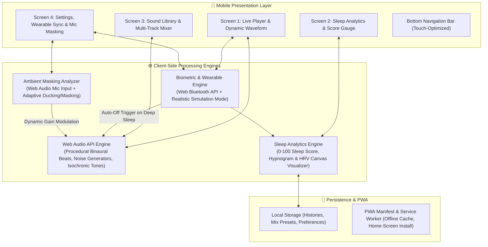

# Sleep Sound Therapy Mobile Web App — Implementation Plan

A mobile-first Progressive Web App (PWA) designed to provide circadian-friendly acoustic therapy, real-time biometric adaptation, environmental noise masking, and sleep quality analytics.

---

## 1. System Architecture & Tech Stack

### Technology Selection
- **Core Languages**: Modern Vanilla HTML5, CSS3 (Modern Flexbox/CSS Grid, CSS Variables, Safe Area Insets), and Modular ES6+ JavaScript.
- **Audio Processing**: Native **Web Audio API** (`AudioContext`, `OscillatorNode`, `StereoPannerNode`, `BiquadFilterNode`, `GainNode`, procedural noise buffers) — no external heavy audio libraries needed, ensuring instant zero-latency playback.
- **Biometric Integration**: Native **Web Bluetooth API** (Standard GATT Heart Rate Profile `0x180D`) with a dual **Hardware / Smart Simulation Mode** supporting Apple Watch, Garmin, and Fitbit profile characteristics.
- **Data Visualization**: Lightweight HTML5 Canvas API for real-time fluid waveform visualizers (60fps), radial sleep score gauges, and hypnogram timeline charts.
- **Deployment**: Static zero-build configuration compatible out-of-the-box with **GitHub Pages** and installable as an offline-first **PWA**.

---

## 2. Design System & Ergonomics

### Color Palette (Melatonin-Protective Dark Theme)
| Role | Color Code | Purpose |
| :--- | :--- | :--- |
| **Deep Void (Base Background)** | `#06070B` | Pure dark backdrop minimizing OLED battery consumption and screen glare |
| **Midnight Navy (Cards & Surfaces)** | `#0D111A` | Secondary surface layer for cards, tab navigation, and audio player bays |
| **Nebula Indigo (Accents & Active)** | `#4F46E5` / `#6366F1` | Primary subtle glowing accents for active states and knobs |
| **Sleep Violet (Binaural & Waveforms)** | `#8B5CF6` / `#A78BFA` | Dynamic waveform color modulating with HRV and theta/delta states |
| **Bio Cyan (Pulse & Wearables)** | `#06B6D4` | Indicates active wearable connectivity and real-time heart rate pulse |
| **Muted Star Dust (Typography)** | `#94A3B8` (sub) / `#F1F5F9` (primary) | Low-contrast text preventing eye strain in low-light environments |

### Mobile Viewport & Ergonomics
- Viewport configuration with `viewport-fit=cover` and iOS notch support (`safe-area-inset-top`, `safe-area-inset-bottom`).
- 48px+ minimum touch targets, haptic feedback hooks (`navigator.vibrate`), and thumb-zone navigation.

---

## 3. Detailed Screen Blueprint

### Screen 1: Real-Time Sound Player
- **Dynamic Waveform Visualizer**: Smooth canvas rendering pulsing sine/noise waves reacting to chosen frequency modes (Delta, Theta, Alpha) and live heart rate pulses.
- **Biometric Telemetry Pill**: Displays current BPM, HRV (rMSSD in ms), and Sleep Phase status (Awake, Light NREM, Deep NREM, REM).
- **Soundscape Quick Selector**: Fast toggling between sound modes (*Deep Delta Sleep*, *Lucid Dreaming Theta*, *Forest Rain & Pink Noise*, *Isochronic Restoration*).
- **Auto-Off Sleep Timer**: Countdown dial (15m, 30m, 45m, 60m, or "Auto-Stop on Deep Sleep Detection" powered by the wearable state).
- **Playback Controls**: Large touch play/pause button, master volume slider, and master fade-out toggle.

### Screen 2: Sleep Quality Analytics Dashboard
- **Daily Sleep Score Gauge**: Animated circular progress meter (0–100 score) computed from sleep duration, deep sleep percentage, HRV baseline stability, and ambient disruptions.
- **Hypnogram Sleep Stage Timeline**: Interactive nocturnal graph showing transitions between Awake, REM, Light NREM, and Deep Sleep.
- **Nocturnal HRV Trend Graph**: Line chart plotting heart rate variability fluctuations over time (indicating parasympathetic nervous system recovery).
- **Personalized Sleep Hygiene Insights**: Actionable cards (e.g., *"3 room noise spikes detected between 2 AM and 4 AM. Increasing Pink Noise masking threshold recommended."*).

### Screen 3: Sound Library & Multi-Track Mixer
- **Categorized Soundscape Library**:
  - **Binaural Beats**: Delta (1-4 Hz deep sleep), Theta (4-8 Hz dream state & meditation), Alpha (8-12 Hz relaxation).
  - **Color Noises**: Procedurally synthesized Pink Noise (1/f decay for sleep stability), Brown Noise (deep rumble for high masking efficiency), and White Noise.
  - **Isochronic Tones**: Periodic acoustic pulses synchronizing brainwave entrainment.
  - **Nature Acoustics**: Calming ambient rain, ocean swells, nighttime crickets, and wind.
- **Multi-Track Mixer Console**:
  - Independent volume faders for up to 4 simultaneous active tracks.
  - Individual Mute / Solo controls and custom preset saver (e.g., *"Rain + 2.5Hz Delta Wave"*).

### Screen 4: Settings & Integrations
- **Wearable Device Manager**:
  - Web Bluetooth GATT connector for real Bluetooth Heart Rate monitors.
  - **Smart Biometric Simulator**: One-tap simulation controls to toggle between Apple Watch, Garmin, or Fitbit data streams, allowing immediate testing of HRV fluctuations and deep-sleep auto-triggering without physical hardware.
- **Environment Sound Masking Setup**:
  - Microphone access permission & real-time ambient decibel meter.
  - Sensitivity threshold slider and dynamic masking response speed (Gradual vs. Immediate).
- **Circadian Theme Tuning**: Color temperature adjustment (Pure Black OLED vs. Dark Navy).
- **Data Management**: Clear history, export sleep log as JSON.

---

## 4. Phased Implementation Roadmap

### Phase 1: Foundation, Design System & Mobile Shell
- Set up responsive mobile shell with CSS variables, reset, and viewport ergonomics.
- Build bottom navigation bar with active state switching between the 4 key screens.
- Implement PWA manifest (`manifest.json`) and service worker configuration for full-screen offline mobile installation.

### Phase 2: Web Audio API Synthesis Engine
- Implement procedural sound generation classes:
  - `BinauralBeatsGenerator`: Dual oscillators (Left/Right channel stereo separation with customizable delta/theta carrier offset).
  - `NoiseGenerator`: Procedural mathematical synthesis of Pink Noise, Brown Noise, and White Noise using buffer arrays and biquad lowpass filtering.
  - `IsochronicToneGenerator`: Gain-modulated pulsing oscillator with variable duty cycle.
  - `NatureAudioEngine`: Web Audio synthesized environmental textures.
- Build the 60fps dynamic canvas waveform visualizer connected to `AudioContext.createAnalyser()`.
- Implement smooth fade-in/fade-out curves to protect waking ears from sudden cutoffs.

### Phase 3: Wearable Integration & Biometric Sync
- Build `WearableService` supporting Web Bluetooth Heart Rate profile (`navigator.bluetooth.requestDevice`).
- Build `BiometricSimulatorService` providing realistic physiological models:
  - Dynamic BPM (45–85 BPM based on sleep stages).
  - Real-time HRV calculation (rMSSD 30–95 ms).
  - Automatic sleep stage transition state machine (Awake -> Light -> Deep -> REM).
  - Trigger event: Deep sleep detection firing the auto-fade timer.

### Phase 4: Ambient Noise Masking Analyzer
- Implement `AmbientNoiseService` leveraging `navigator.mediaDevices.getUserMedia`.
- Compute real-time ambient noise decibel / RMS levels using a lightweight Web Audio script node or analyzer node.
- Build adaptive ducking and counter-masking: when room noise surges (e.g., car horn, doors closing), the app automatically boosts pink/brown noise layers to prevent arousal from sleep.

### Phase 5: Sleep Score Engine & Analytics Visualizer
- Develop the Sleep Quality algorithm:
  - `Score = Duration (30%) + Deep Sleep Ratio (25%) + HRV Stability (25%) + Disruption Count (20%)`.
- Create Canvas-based high-resolution rendering for:
  - Radial Sleep Score Gauge with glowing circadian gradient.
  - Hypnogram sleep stage timeline with time markers.
  - Overnight HRV trend line graph.
- Implement rule-based personalized sleep hygiene engine generating dynamic advice based on nocturnal data.

### Phase 6: Sound Mixer & Custom Presets
- Construct multi-track mixing console in Screen 3 with slider handles, track toggles, and state persistence in `localStorage`.
- Provide curated default presets (*"Deep Theta Slumber"*, *"Turbulent Rain Masking"*, *"Circadian Delta Reset"*).

### Phase 7: Verification, Mobile Optimization & GitHub Pages Deployment
- Test responsive layout on various viewport sizes (iPhone, Android, tablet).
- Verify audio playback behavior across mobile browsers (handling iOS/Android user gesture audio unlock constraints).
- Prepare git repository structure and verify local and GitHub Pages deployment readiness.
